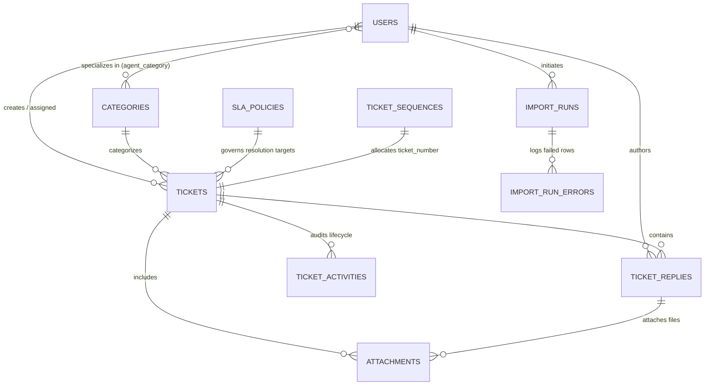

# Enterprise Support Desk System

[](https://www.php.net/)
[](https://laravel.com/)
[](https://www.mysql.com/)
[-success?style=flat&logo=phpunit&logoColor=white)](https://phpunit.de/)
[](https://laravel.com/docs/pint)
[](https://en.wikipedia.org/wiki/Domain-driven_design)

A high-performance, concurrency-resilient IT Service Desk and Ticketing platform built with **Laravel 13**, **PHP 8.3**, and **MySQL 8.0 InnoDB**. 

Engineered to meet enterprise reliability standards, this system provides business-hours SLA lifecycle tracking, concurrency-safe atomic ticket claiming, strict role-based data isolation, streaming chunked CSV ingestion, and single-pass analytical operational dashboards.

---

## Table of Contents

- [Core Architectural Highlights](#core-architectural-highlights)
- [System Architecture & Entity Schema](#system-architecture--entity-schema)
- [Role-Based Access Control (RBAC)](#role-based-access-control-rbac)
- [Technology Stack](#technology-stack)
- [Prerequisites & System Requirements](#prerequisites--system-requirements)
- [Installation & Quickstart Guide](#installation--quickstart-guide)
- [Background Workers & Scheduler Setup](#background-workers--scheduler-setup)
- [Default Demo Credentials](#default-demo-credentials)
- [Key Workflows & Implementation Details](#key-workflows--implementation-details)
  - [1. Concurrency-Safe Ticket Claiming](#1-concurrency-safe-ticket-claiming)
  - [2. Business-Hours SLA Engine](#2-business-hours-sla-engine)
  - [3. Gap-Free Sequential Ticket Numbers](#3-gap-free-sequential-ticket-numbers)
  - [4. Internal Notes & Customer Isolation](#4-internal-notes--customer-isolation)
  - [5. Streaming Chunked CSV Import](#5-streaming-chunked-csv-import)
- [Testing & Quality Assurance](#testing--quality-assurance)
- [Directory Structure](#directory-structure)
- [License](#license)

---

## Core Architectural Highlights

| Feature | Engineering Implementation |
|---|---|
| **Atomic Concurrency Claim** | Conditional SQL updates (`WHERE id = ? AND assigned_agent_id IS NULL`) preventing race conditions when multiple agents attempt to claim the same unassigned ticket simultaneously, returning `409 Conflict` on contention. |
| **Business-Hours SLA Engine** | Calculates resolution deadlines strictly within custom business hours (**Sunday–Thursday, 09:00–18:00 in `Asia/Dhaka`**). Automatically rolls over weekend windows and triggers real-time escalation alerts upon breach. |
| **Gap-Free Sequential IDs** | Guarantees sequential, human-readable numbers (`TKT-YYYY-000001`) with automatic yearly rollover and row-level locking (`lockForUpdate()`), supporting batch pre-allocations (`reserveRange()`). |
| **Private Attachment Vault** | File attachments are strictly stored on private storage disks (`storage/app/private`) with MIME verification, SHA-256 fingerprinting, and authorized streaming downloads via Laravel Policies. |
| **Role-Isolated Internal Notes** | Agents and Administrators can converse internally using private notes (`is_internal = true`) that are completely invisible to Customers at both database query and policy levels. |
| **Streaming Chunked CSV Import** | Ingests enterprise-scale ticket datasets in memory-efficient 500-row chunks using `SplFileObject`, deduplicating via `external_ref` and capturing row-by-row validation errors into a downloadable CSV report. |
| **Real-Time Operational Metrics** | Dashboard analytics calculated in a single-pass query using SQL conditional aggregation (`SUM(CASE WHEN ...)`), displaying SLA breach rates, agent capacity, and workload distribution. |

---

## System Architecture & Entity Schema



---

## Role-Based Access Control (RBAC)

The application enforces three distinct authorization tiers backed by the `UserRole` PHP 8.3 backed enum and strict route middleware (`EnsureUserHasRole`):

| Capability / Resource | Customer | Support Agent | Administrator |
|---|:---:|:---:|:---:|
| Create Tickets | Yes | Yes | Yes |
| View Own Tickets | Yes | Yes | Yes |
| View All / Category Tickets | No | Yes | Yes |
| Claim / Accept Unassigned Ticket | No | Yes | Yes |
| Auto-Assign / Manual Reassignment | No | No | Yes |
| Public Reply to Tickets | Yes | Yes | Yes |
| Post Internal Private Notes | **Forbidden** | Yes | Yes |
| View Internal Notes | **Forbidden** | Yes | Yes |
| Change Ticket Priority | No | Yes | Yes |
| Download Ticket Attachments | Own Tickets Only | Accessible Tickets | All Tickets |
| Trigger Bulk CSV Import | No | No | Yes |
| View Error CSV Logs & Runs | No | No | Yes |
| View Operational Dashboard | Scoped Stats | Team Workload | Full Enterprise KPIs |

---

## Technology Stack

- **Framework**: [Laravel 13.x](https://laravel.com/)
- **PHP Version**: PHP 8.3+ (Strict types enabled across all classes)
- **Primary Database**: MySQL 8.0+ InnoDB (Engineered with Composite Indexes & Full-Text Search)
- **Test Database**: In-Memory SQLite (Schema-compatible test runner)
- **Frontend / UI**: Clean Blade components styled with Tailwind CSS and Alpine.js (Instant CDN delivery, zero build friction)
- **Queue / Background Jobs**: Laravel Queue Worker (Database / Sync driver)
- **Scheduler**: Laravel Artisan Scheduler (`routes/console.php`)
- **Code Linter & Formatter**: Laravel Pint

---

## Prerequisites & System Requirements

- **PHP**: `^8.3` with extensions: `pdo_mysql`, `mbstring`, `openssl`, `bcmath`, `curl`, `ctype`, `xml`
- **Composer**: `^2.2`
- **MySQL**: `^8.0`
- **Web Server**: Nginx / Apache / `php artisan serve`

---

## Installation & Quickstart Guide

### 1. Clone the Repository
```bash
git clone https://github.com/your-org/support-desk.git
cd support-desk
```

### 2. Install PHP Dependencies
```bash
composer install
```

### 3. Environment Configuration
Copy the sample environment file and configure your MySQL credentials:
```bash
cp .env.example .env
```

Ensure your `.env` contains your MySQL database connection:
```ini
APP_NAME="Support Desk"
APP_ENV=local
APP_KEY=
APP_DEBUG=true
APP_TIMEZONE="Asia/Dhaka"
APP_URL=http://localhost:8000

DB_CONNECTION=mysql
DB_HOST=127.0.0.1
DB_PORT=3306
DB_DATABASE=support_desk
DB_USERNAME=root
DB_PASSWORD=your_password

QUEUE_CONNECTION=database
FILESYSTEM_DISK=local
```

### 4. Generate Application Encryption Key
```bash
php artisan key:generate
```

### 5. Run Migrations & Seed Dummy Data
Execute database schema creation along with the comprehensive demo seeders:
```bash
php artisan migrate:fresh --seed
```

### 6. Create Storage Symlink
Link the storage directory for public assets:
```bash
php artisan storage:link
```

### 7. Start the Local Server
```bash
php artisan serve
```
Visit `http://localhost:8000` in your web browser.

---

## Background Workers & Scheduler Setup

### Queue Worker (Required for Asynchronous Notifications & CSV Imports)
Run the queue worker to process asynchronous notifications and streaming CSV import jobs:
```bash
php artisan queue:work --queue=default --tries=3 --timeout=300
```

### SLA Escalation Engine & Scheduler
The automated SLA escalation command `tickets:escalate-sla` is scheduled to run every minute in `routes/console.php`.

For local testing and development:
```bash
php artisan schedule:work
```

For production deployment, add the standard Laravel Cron entry to your server (`crontab -e`):
```cron
* * * * * cd /path-to-your-project && php artisan schedule:run >> /dev/null 2>&1
```

---

## Default Demo Credentials

Running `php artisan migrate:fresh --seed` populates the database with realistic demo accounts:

| Role | Email | Password | Details |
|---|---|---|---|
| **Administrator** | `admin@supportdesk.test` | `password` | Full administrative control, CSV import, manual assignment |
| **Support Agent 1** | `agent1@supportdesk.test` | `password` | Tier 2 Support (Technical Support, Infrastructure) |
| **Support Agent 2** | `agent2@supportdesk.test` | `password` | Operations Specialist (Technical Support, Feature Requests) |
| **Support Agent 3** | `agent3@supportdesk.test` | `password` | Security & Infrastructure Specialist |
| **Support Agent 4** | `agent4@supportdesk.test` | `password` | Billing & Invoicing Specialist |
| **Customer 1** | `customer1@supportdesk.test` | `password` | Acme Corp (Sample active tickets & replies) |
| **Customer 2** | `customer2@supportdesk.test` | `password` | Globex Industries |
| **Customer 3** | `sarah@cyberdyne.test` | `password` | Cyberdyne Systems (Okta SSO resolution thread) |

---

## Key Workflows & Implementation Details

### 1. Concurrency-Safe Ticket Claiming
When multiple agents simultaneously attempt to click **"Accept Ticket"**, conventional check-then-act logic suffers from race conditions. This system uses conditional row-level atomic execution:
```php
// app/Services/Tickets/TicketAssignmentService.php
$affected = DB::table('tickets')
    ->where('id', $ticket->id)
    ->whereNull('assigned_agent_id')
    ->update([
        'assigned_agent_id' => $agent->id,
        'assigned_at' => now(),
        'status' => TicketStatus::InProgress->value,
    ]);

if ($affected === 0) {
    throw new TicketAlreadyAssignedException('Ticket has already been claimed by another agent.');
}
```
If two agents click claim concurrently, one succeeds (HTTP 302 redirect) while the other receives an immediate **`409 Conflict`** response with a clean error message.

---

### 2. Business-Hours SLA Engine
SLA targets are defined in minutes per priority (`Critical`: 120m, `High`: 480m, `Medium`: 1440m, `Low`: 2880m). Rather than naive 24/7 calendar addition, the SLA engine evaluates business hours:
- **Work Days**: Sunday through Thursday (Friday & Saturday are weekends).
- **Work Hours**: 09:00 to 18:00 (9 working hours / 540 minutes per day).
- **Timezone**: `Asia/Dhaka` (Configurable in `config/sla.php`).

*Example*: A Critical ticket (2 hours SLA) submitted on Thursday at 17:00 will consume 1 hour until Thursday 18:00 close, skip Friday and Saturday, and mature on **Sunday at 10:00 AM**.

---

### 3. Gap-Free Sequential Ticket Numbers
Ticket numbers follow the standard enterprise format `TKT-YYYY-000001` (e.g. `TKT-2026-000001`).
Implemented via `TicketNumberGenerator`:
- Utilizes pessimistic row locking (`lockForUpdate()`) on the `ticket_sequences` table.
- Automatically handles yearly rollover.
- Provides `reserveRange(int $count)` to allocate continuous blocks of numbers for bulk imports without lock contention.

---

### 4. Internal Notes & Customer Isolation
- Support conversations support two visibility modes: **Public Replies** and **Internal Notes**.
- Internal notes (`is_internal = true`) are strictly visible only to users with the `agent` or `admin` role.
- Replying automatically advances ticket state:
  - Agent public reply $\rightarrow$ transitions status to `Waiting for Customer`.
  - Customer reply $\rightarrow$ transitions status to `In Progress` or reopens ticket.
  - Internal note $\rightarrow$ leaves the ticket status unchanged.

---

### 5. Streaming Chunked CSV Import
Administrators can bulk-import thousands of tickets via `/imports`:
- **Streaming Ingestion**: Reads large files using `SplFileObject` to ensure constant $O(1)$ memory usage.
- **Chunked Processing**: Processes records in 500-row batches within database transactions.
- **Deduplication**: Validates incoming `external_ref` values against existing records to prevent duplicates.
- **Error Tracking**: Malformed or invalid rows are captured into `import_run_errors` with row numbers and field-level validation messages.
- **Exportable Error CSV**: Admins can download an error-annotated CSV containing only the failed rows for rapid correction and re-upload.

---

## Testing & Quality Assurance

The application includes an extensive test suite verifying business logic, authorization boundaries, concurrent race conditions, SLA boundaries, and file security.

### Run All Unit & Feature Tests
```bash
vendor/bin/phpunit
```

### Run Specific Test Suites
```bash
# SLA Engine & Timezone Boundary Tests
vendor/bin/phpunit tests/Unit/SlaCalculatorTest.php

# Concurrency Claim & Race Collision Tests
vendor/bin/phpunit tests/Feature/TicketAssignmentTest.php

# CSV Streaming Import & Deduplication Tests
vendor/bin/phpunit tests/Feature/TicketImportTest.php

# Internal Notes Authorization & Isolation Tests
vendor/bin/phpunit tests/Feature/TicketConversationTest.php

# Database Seeder Verification
vendor/bin/phpunit tests/Feature/DatabaseSeederTest.php
```

### Code Formatting & Standards
Ensure compliance with Laravel standards and PSR-12/PER-CS:
```bash
vendor/bin/pint --format agent
```

---

## Directory Structure

```text
app/
├── Enums/                     # Backed Enums (UserRole, TicketPriority, TicketStatus, ActivityType, ImportStatus)
├── Events/                    # Lifecycle events (TicketCreated, TicketAssigned, TicketReplied, TicketEscalated, etc.)
├── Http/
│   ├── Controllers/           # Controllers (Ticket, Assignment, Reply, Attachment, Import, Dashboard)
│   ├── Middleware/            # EnsureUserHasRole middleware
│   └── Requests/              # Validated Form Requests (StoreTicketRequest, StoreReplyRequest, etc.)
├── Jobs/                      # Background queued jobs (ProcessTicketImport)
├── Listeners/                 # Event subscribers (SendTicketNotifications)
├── Models/                    # Eloquent Models & relationships
├── Notifications/             # Asynchronous Mail/Database notifications
├── Policies/                  # Authorization policies (TicketPolicy, AttachmentPolicy)
└── Services/
    ├── Activity/              # Audit logging service (ActivityLogger)
    ├── Import/                # Streaming CSV processing service (TicketImportService)
    ├── Sla/                   # BusinessHours, SlaCalculator, SlaStatusResolver
    └── Tickets/               # TicketService, TicketAssignmentService, TicketNumberGenerator, TicketFilter
database/
├── factories/                 # Eloquent Factories for all models
├── migrations/                # Database schema migrations
└── seeders/                   # Modular seeders (Category, SlaPolicy, User, Ticket, ImportRun)
resources/views/
├── auth/                      # Authentication views (Login, Register)
├── dashboard.blade.php        # Operational metrics dashboard
├── imports/                   # CSV upload & progress tracking views
├── layouts/                   # App and Guest Blade layouts (Tailwind + Alpine)
└── tickets/                   # Ticket listing, filter sidebar, creation form, conversation thread
```

---

## License

This project is open-source software licensed under the [MIT License](LICENSE).
