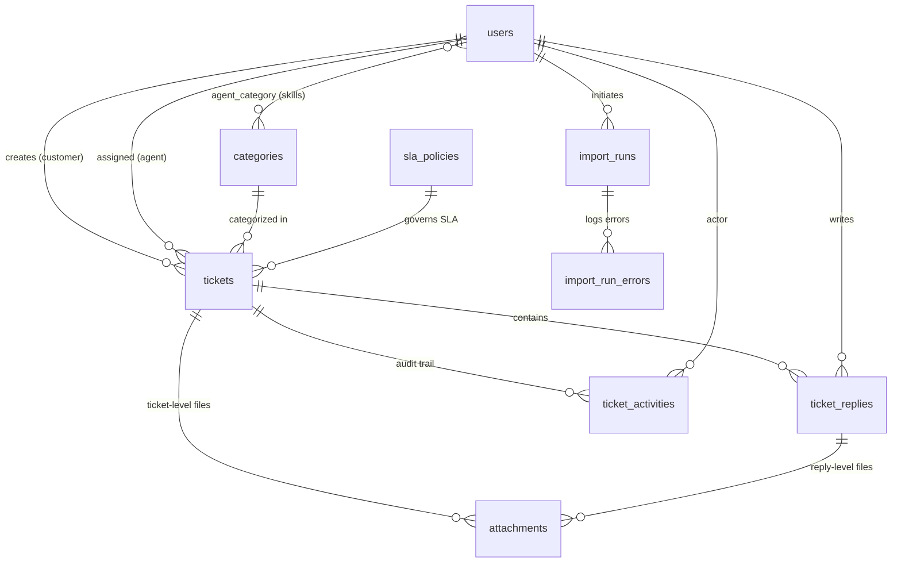

# Support Ticket & SLA Management System
## Master Implementation Plan & Development Ticket Backlog

---

## 1. Project Overview & Architecture Blueprint

### 1.1 Technical Stack & Decisions
| Component | Technology | Rationale |
|---|---|---|
| **Framework** | Laravel 11/12+ on PHP 8.3 | High productivity, native type safety, robust scheduler and queue architecture |
| **Database** | MySQL 8.0+ (InnoDB) | Primary database engine across local dev, testing, and production. Supports native row-level locking (`SELECT ... FOR UPDATE`), transaction isolation, composite indexing, and FULLTEXT indexes (`MATCH ... AGAINST`). |
| **Frontend** | Blade + Tailwind CSS + Alpine.js | Clean, responsive, server-side rendered UI ensuring authorization logic remains 100% server-side |
| **Queues & Async** | Database / Redis with `queue:work` | Non-blocking email dispatch, scheduled escalations, and chunked CSV imports |
| **Scheduler** | Laravel Scheduler (`schedule:work` / cron) | Every-minute execution of SLA warnings, breaches, and auto-escalations |
| **Testing** | PHPUnit / Pest | Feature and Unit coverage for critical business logic (SLA calculations, race conditions, auth boundaries) |
| **MCP Integration** | Laravel Boost (`laravel/boost` + `laravel/mcp`) | Standardized tool integration, guidelines, and context awareness |

### 1.2 Architectural Layers
```
┌─────────────────────────────────────────────────────────────┐
│                      HTTP Layer                             │
│  Controllers (Thin) ──► FormRequests (Validation)           │
│                     ──► Policies / Gates (Authorization)    │
└──────────────────────────────┬──────────────────────────────┘
                               │
┌──────────────────────────────▼──────────────────────────────┐
│                    Domain Service Layer                     │
│  • TicketService            • SlaCalculator / BusinessHours │
│  • TicketAssignmentService  • TicketNumberGenerator         │
│  • TicketFilter             • ActivityLogger                │
│  • TicketImportService                                      │
└──────────────────────────────┬──────────────────────────────┘
                               │
┌──────────────────────────────▼──────────────────────────────┐
│                     Data & Persistence                      │
│  • Eloquent Models with explicit type casts & Enums        │
│  • Scopes: scopeVisibleTo(), scopeFilter(), scopeSlaStatus()│
│  • Atomic conditional updates & DB transactions             │
└──────────────────────────────┬──────────────────────────────┘
                               │
┌──────────────────────────────▼──────────────────────────────┐
│                     Asynchronous Layer                      │
│  • Events & Listeners (ShouldDispatchAfterCommit)           │
│  • Queued Mail & Database Notifications (ShouldQueue)       │
│  • Scheduled Escalation Command: tickets:escalate-sla       │
│  • Queued Chunked Import Job: ProcessTicketImport           │
└─────────────────────────────────────────────────────────────┘
```

---

## 2. Core Technical Designs & Interview Solutions

### 2.1 Concurrency-Safe Ticket Accept (Solving Race Conditions)
- **Problem**: Two support agents click "Accept Ticket" at the exact same millisecond on an unassigned ticket.
- **Flawed Solution**: `if ($ticket->assigned_agent_id === null) { $ticket->update([...]); }` (Time-of-check to time-of-use race condition).
- **Engineered Solution**: Single atomic conditional database update:
  ```php
  $affected = Ticket::query()
      ->whereKey($ticket->id)
      ->whereNull('assigned_agent_id')
      ->whereNotIn('status', [TicketStatus::Resolved, TicketStatus::Closed])
      ->update([
          'assigned_agent_id' => $agent->id,
          'assigned_at'       => now(),
          'status'            => TicketStatus::InProgress,
          'version'           => DB::raw('version + 1'),
      ]);
  ```
  If `$affected === 0`, another agent has already acquired the ticket. Return `409 Conflict` or a clear UI warning.

### 2.2 Guaranteed Unique Ticket Number Generation
- **Format**: `TKT-YYYY-000001` (e.g. `TKT-2026-000001`).
- **Solution**: Dedicated `ticket_sequences` table with year primary key. Inside a transaction, perform `lockForUpdate()` on the row for the current year, increment `last_number`, and format with `sprintf('TKT-%d-%06d', $year, $next)`.
- **Safety**: Serialized through row-level locking + unique index constraint on `tickets.ticket_number`. For bulk imports, allocate ranges (`last_number += N`) in a single query.

### 2.3 Business Hours SLA Engine
- **Business Calendar**: Sunday to Thursday, 09:00 to 18:00 (`Asia/Dhaka`).
- **Priorities & Resolution Durations**:
  - `Critical`: 2 Business Hours (120 min)
  - `High`: 8 Business Hours (480 min)
  - `Medium`: 24 Business Hours (1,440 min)
  - `Low`: 48 Business Hours (2,880 min)
- **Algorithm**:
  - Convert start timestamp to business timezone.
  - While remaining minutes > 0:
    - Jump forward to the next open business moment if currently in off-hours or weekend.
    - Calculate available business minutes until closing (18:00) of the current day.
    - If remaining <= available, add remaining minutes and convert back to UTC.
    - Otherwise, subtract available minutes and advance cursor to 09:00 of the next business day.
- **Precomputed Warning**: `sla_warning_at = start + (resolution_minutes * 0.80)` in business minutes. Stored as a first-class column with database index for $O(1)$ query scanning.

### 2.4 Internal Notes & Information Leak Prevention
- **Database**: `ticket_replies.is_internal` boolean column.
- **Strict Query Scoping**: `TicketReply::scopeVisibleTo($user)` automatically appends `where('is_internal', false)` when `$user->isCustomer()`.
- **Attachment Protection**: Attachments inherit visibility from parent reply. Customer requests to download an attachment on an internal note receive `403 Forbidden`.
- **Notifications**: Notification listener explicitly verifies `is_internal` flag; customer notification jobs are never dispatched for internal notes.

---

## 3. Database Schema Blueprint



---

## 4. Sequenced Development Ticket Backlog

```
Phase 1: Foundations & Auth ──► TKT-01, TKT-02, TKT-03
Phase 2: SLA & Core Domain  ──► TKT-04, TKT-05, TKT-06
Phase 3: Collaboration     ──► TKT-07, TKT-08
Phase 4: Automation & Async ──► TKT-09, TKT-10
Phase 5: Search, Import, UI ──► TKT-11, TKT-12, TKT-13
```

---

### [TKT-01] Authentication, User Roles & Authorization Scaffolding
- **Type**: Foundation / Security
- **Objective**: Establish authentication and role-based access control (`admin`, `agent`, `customer`).
- **Scope & Implementation**:
  - Install Laravel Breeze (Blade stack) for clean session authentication.
  - Add `role` (enum: `admin`, `agent`, `customer`), `is_available` (boolean default true), `last_assigned_at` (timestamp null), and `max_open_tickets` (unsigned smallint null) to `users` table.
  - Implement `UserRole` PHP Enum with helper methods: `isAdmin()`, `isAgent()`, `isCustomer()`.
  - Create Role Middleware / Gates to safeguard route groups.
  - Database seeders with default accounts:
    - Admin: `admin@supportdesk.test`
    - Support Agents: `agent1@supportdesk.test`, `agent2@supportdesk.test`
    - Customers: `customer1@supportdesk.test`, `customer2@supportdesk.test`
- **Acceptance Criteria**:
  - [ ] Users can register/login with their respective roles.
  - [ ] Route middleware restricts admin/agent-only portals.
  - [ ] Unit & Feature tests verify role assignments and unauthorized redirects.

---

### [TKT-02] Database Schema Migrations, Models & Enums
- **Type**: Backend / Database
- **Objective**: Create migrations, models, relationships, and factories for all domain entities.
- **Scope & Implementation**:
  - Enums: `TicketPriority` (`low`, `medium`, `high`, `critical`), `TicketStatus` (`open`, `in_progress`, `waiting_for_customer`, `resolved`, `closed`), `ActivityType`, `ImportStatus`.
  - Tables:
    - `categories` (`id`, `name`, `slug`, `is_active`, timestamps)
    - `agent_category` pivot table (`user_id`, `category_id`, composite PK)
    - `sla_policies` (`id`, `priority`, `resolution_minutes`, `warning_threshold_percent`, `is_active`)
    - `ticket_sequences` (`year` PK, `last_number`)
    - `tickets` (`id`, `ticket_number` UNIQUE, `external_ref` UNIQUE NULL, `subject`, `description`, `priority`, `status`, `category_id` FK, `created_by` FK, `assigned_agent_id` FK NULL, `assigned_at`, `sla_due_at`, `sla_warning_at`, `approaching_notified_at`, `breached_at`, `escalated_at`, `escalation_count`, `resolved_at`, `closed_at`, `version`, soft deletes, timestamps)
    - Composite indexes: `(status, priority)`, `(assigned_agent_id, status)`, `(created_by, status)`, `(status, sla_due_at)`, `(status, sla_warning_at)`.
    - MySQL FULLTEXT index: `fullText(['subject', 'description'])` for keyword searches.
    - Database engine: MySQL 8.0 (InnoDB) with `utf8mb4` charset and `utf8mb4_unicode_ci` collation.
    - `ticket_replies` (`id`, `ticket_id` FK cascade, `user_id` FK, `body`, `is_internal`, timestamps)
    - `attachments` (`id`, `ticket_id` FK cascade, `ticket_reply_id` FK NULL, `uploaded_by` FK, `original_name`, `path`, `mime_type`, `size_bytes`, `sha256`, timestamps)
    - `ticket_activities` (`id`, `ticket_id` FK cascade, `user_id` FK NULL, `type`, `old_value`, `new_value`, `metadata` JSON, `created_at`)
    - `import_runs` & `import_run_errors`
  - Eloquent model relationships, eager loading defaults, and model factories.
- **Acceptance Criteria**:
  - [ ] All migrations run cleanly on MySQL (`php artisan migrate:fresh`).
  - [ ] Foreign keys cascade appropriately on deletion under InnoDB.
  - [ ] Model factories generate realistic test states.

---

### [TKT-03] High-Concurrency Sequential Ticket Number Generator
- **Type**: Backend / Service
- **Objective**: Implement zero-collision, sequential ticket number generation with yearly resets.
- **Scope & Implementation**:
  - Create `App\Services\Tickets\TicketNumberGenerator`.
  - Number format: `TKT-YYYY-000001` (e.g., `TKT-2026-000001`).
  - Method `next(?CarbonInterface $now = null): string`:
    - Wraps sequence acquisition inside `DB::transaction()`.
    - Uses `DB::table('ticket_sequences')->where('year', $year)->lockForUpdate()`.
    - Handles first-of-year creation via `insertOrIgnore` or `firstOrCreate`.
    - Increments counter and returns formatted zero-padded string.
  - Method `reserveRange(int $count, ?CarbonInterface $now = null): array` for bulk CSV import.
- **Acceptance Criteria**:
  - [ ] Generates sequential numbers starting at `000001` for the current year.
  - [ ] Resets counter to `000001` when the calendar year rolls over.
  - [ ] Concurrent tests verify no duplicate numbers are ever issued.

---

### [TKT-04] Business Hours SLA Engine & Policy Configuration
- **Type**: Backend / Core Logic
- **Objective**: Implement accurate resolution deadlines and warning windows according to configurable business hours.
- **Scope & Implementation**:
  - Config file `config/sla.php`:
    - `timezone` => `env('SLA_TIMEZONE', 'Asia/Dhaka')`
    - `business_days` => `[0, 1, 2, 3, 4]` (Sunday=0 to Thursday=4)
    - `business_start` => `09:00`
    - `business_end` => `18:00`
  - Service `App\Services\Sla\SlaCalculator`:
    - `calculateDueAt(CarbonInterface $from, int $businessMinutes): CarbonImmutable`
    - `calculateWarningAt(CarbonInterface $from, int $businessMinutes, int $thresholdPercent = 80): CarbonImmutable`
    - Helper `nextBusinessMoment(CarbonInterface $moment): CarbonImmutable` to fast-forward past weekends and nights.
  - Service `App\Services\Sla\SlaStatusResolver`:
    - Computes dynamic status: `met`, `breached`, `approaching`, `within`.
  - Eloquent Query Scopes on `Ticket`:
    - `scopeSlaBreached($query)`
    - `scopeSlaApproaching($query)`
    - `scopeSlaWithin($query)`
- **Acceptance Criteria**:
  - [ ] A Critical ticket (2h) created Thursday 17:00 calculates due date as Sunday 10:00.
  - [ ] Ticket created Friday or Saturday starts its SLA clock Sunday at 09:00.
  - [ ] Ticket created before 09:00 starts at 09:00 on the same business day.
  - [ ] Warning timestamp reflects exactly 80% elapsed business time.
  - [ ] Unit tests cover all boundary conditions (before hours, after hours, weekends, multi-day span).

---

### [TKT-05] Ticket CRUD, Lifecycle & Visibility Policies
- **Type**: Backend & Frontend
- **Objective**: Full ticket management with server-side authorization and status workflow.
- **Scope & Implementation**:
  - Requests: `StoreTicketRequest`, `UpdateTicketRequest`.
  - Service: `TicketService::create()`, `TicketService::update()`, `TicketService::changeStatus()`.
  - Valid status transitions:
    - `open` -> `in_progress` -> `waiting_for_customer` -> `in_progress` -> `resolved` -> `closed`.
    - Allow reopening from `resolved` -> `in_progress`.
  - Record `resolved_at` and `closed_at` timestamps upon reaching corresponding statuses.
  - Policy `TicketPolicy`:
    - Customers can only view and update their own tickets while open.
    - Agents can view tickets assigned to them or unassigned tickets.
    - Admins can view/manage all tickets.
  - Scope `Ticket::scopeVisibleTo(User $user)` to prevent data leakage in index queries.
- **Acceptance Criteria**:
  - [ ] Customer cannot view another customer's ticket (returns 403 / 404).
  - [ ] Tickets recalculate SLA due date if priority is updated while open.
  - [ ] Status changes record timestamps and trigger audit activity.

---

### [TKT-06] Ticket Assignment Engine & Concurrent Accept Protection
- **Type**: Backend / Core Logic
- **Objective**: Manual assignment, automated least-workload distribution, and race-condition-safe ticket acceptance.
- **Scope & Implementation**:
  - Service `App\Services\Tickets\TicketAssignmentService`:
    - `assign(Ticket $ticket, User $agent, ?User $actor = null): bool`
    - `autoAssign(Ticket $ticket): ?User`:
      1. Filter agents where `is_available = true`.
      2. Match category skill via `agent_category` pivot if ticket has category.
      3. Filter out agents who have reached `max_open_tickets`.
      4. Single query aggregate to find agent with least open tickets (`status not in ('resolved', 'closed')`).
      5. Tie-break using oldest `last_assigned_at` (round-robin).
    - `accept(Ticket $ticket, User $agent): bool`:
      - Execute conditional update: `WHERE id = ? AND assigned_agent_id IS NULL AND status NOT IN ('resolved', 'closed')`.
      - Returns true if 1 row updated, false if 0 rows updated.
  - Controller: `TicketAssignmentController@accept` returns `409 Conflict` if false.
- **Acceptance Criteria**:
  - [ ] Automated assignment picks lowest-workload agent with matching category skill.
  - [ ] Round-robin tie-breaking works when open ticket counts are equal.
  - [ ] Feature test simulates simultaneous accept requests; exactly one agent succeeds and the other receives a conflict error.

---

### [TKT-07] Ticket Conversation & Secure Internal Notes
- **Type**: Backend & Frontend
- **Objective**: Enable threaded communications with complete isolation of private agent notes.
- **Scope & Implementation**:
  - Request: `StoreReplyRequest` (validates `body`, optional `is_internal`).
  - Authorization:
    - Customer cannot post `is_internal = true` (enforced in FormRequest & Policy).
    - Customer list query applies `scopeVisibleTo` which strictly filters `where('is_internal', false)`.
  - Status progression:
    - Customer reply on `waiting_for_customer` switches status back to `in_progress`.
    - Agent reply has an optional toggle to switch status to `waiting_for_customer`.
  - Dispatches `TicketReplied` event (only if public reply or intended for agents).
- **Acceptance Criteria**:
  - [ ] Internal notes are never visible in customer views, payloads, or database queries.
  - [ ] Customers attempting to submit `is_internal=true` have the flag stripped or rejected.
  - [ ] Customer reply transitions status to `in_progress`.

---

### [TKT-08] Secure File Attachment Management
- **Type**: Backend & Security
- **Objective**: Support file attachments on tickets and replies with secure private storage and authorized streaming.
- **Scope & Implementation**:
  - Disk: Private local filesystem (`storage/app/private`), never exposed via public symlink.
  - Validation: Max 5MB per file, allowed MIME types: PDF, PNG, JPG, JPEG, GIF, TXT, CSV, DOCX, XLSX.
  - Server-side MIME verification using `getMimeType()` to prevent executable/SVG uploads.
  - Storage path hashed with UUID: `tickets/{ticket_id}/{uuid}.{ext}`. Store `original_name` for display only.
  - Download endpoint `GET /attachments/{attachment}`:
    - Protected by `AttachmentPolicy`: checks if user can view parent ticket AND that customer cannot download attachments tied to internal notes.
    - Serves file via `Storage::download()` with `X-Content-Type-Options: nosniff`.
- **Acceptance Criteria**:
  - [ ] SVG and executable files are rejected during upload.
  - [ ] Direct file access via public URL is impossible.
  - [ ] Customer cannot download attachments linked to internal agent notes.

---

### [TKT-09] SLA Escalation Scheduler & Idempotent Monitoring
- **Type**: Backend / Automation
- **Objective**: Background scheduler to detect approaching and breached SLAs, apply escalations, and log history.
- **Scope & Implementation**:
  - Artisan command: `php artisan tickets:escalate-sla`.
  - Registered in `bootstrap/app.php` or `routes/console.php` to run `everyMinute()->withoutOverlapping()`.
  - Approaching SLA logic:
    - Scan open tickets where `sla_warning_at <= now()`, `sla_due_at > now()`, and `approaching_notified_at IS NULL`.
    - Chunk by 200, perform atomic conditional update: `SET approaching_notified_at = now() WHERE approaching_notified_at IS NULL`.
    - Dispatch `SlaApproaching` event and log audit activity.
  - Breached SLA / Escalation logic:
    - Scan open tickets where `sla_due_at < now()` and `escalated_at IS NULL`.
    - Chunk by 200, perform atomic update: `SET breached_at = now(), escalated_at = now(), escalation_count = escalation_count + 1 WHERE escalated_at IS NULL`.
    - Dispatch `TicketEscalated` event and log audit activity.
- **Acceptance Criteria**:
  - [ ] Multiple consecutive runs do not re-escalate or duplicate notifications (idempotency).
  - [ ] Resolved and closed tickets are excluded from escalation scans.
  - [ ] Database index on `(status, sla_warning_at)` and `(status, sla_due_at)` prevents table scans.

---

### [TKT-10] Asynchronous Event & Notification Pipeline
- **Type**: Backend / Queues
- **Objective**: Queue-driven mail and database notifications for all critical ticket lifecycle events.
- **Scope & Implementation**:
  - Events:
    - `TicketCreated`, `TicketAssigned`, `TicketReplied`, `TicketResolved`, `SlaApproaching`, `TicketEscalated`.
  - Event listeners implement `ShouldQueue` with `ShouldDispatchAfterCommit`.
  - Notifications:
    - Deliver via `database` and `mail` channels.
    - Customer notified on: creation confirmation, assignment, public replies, resolution.
    - Agent notified on: assignment, customer reply, SLA warning, SLA breach.
    - Admins notified on: unassigned ticket alerts, SLA breach escalation.
- **Acceptance Criteria**:
  - [ ] User requests are never blocked by email delivery (all notifications queued).
  - [ ] Events are dispatched only after DB transactions successfully commit.
  - [ ] Tests verify queued notifications using `Notification::fake()`.

---

### [TKT-11] Advanced Ticket Search, Multi-Filter & Index Optimization
- **Type**: Backend & UI
- **Objective**: High-performance ticket searching, filtering, and paginated views.
- **Scope & Implementation**:
  - Query Filter class: `App\Services\Tickets\TicketFilter`.
  - Supported filters:
    - `ticket_number` (prefix search using index)
    - `keyword` (`LIKE %search%` across subject and description)
    - `status` (multi-select)
    - `priority` (multi-select)
    - `category_id`
    - `assigned_agent_id` (including `unassigned` option)
    - `created_by` (for admins and agents)
    - `sla_status` (`within`, `approaching`, `breached`)
    - `date_from` and `date_to`
  - Eager load `category:id,name`, `assignedAgent:id,name`, `creator:id,name`.
  - Paginate results (20 per page) with query string preservation.
- **Acceptance Criteria**:
  - [ ] No N+1 queries when rendering list with relationships.
  - [ ] Customers can only filter within their own permitted tickets.
  - [ ] Fast indexed lookups for status, priority, and ticket numbers.

---

### [TKT-12] High-Capacity CSV Import Pipeline
- **Type**: Backend / Processing
- **Objective**: Stream and process large CSV ticket files in chunks without memory exhaustion.
- **Scope & Implementation**:
  - Request: `ImportTicketsRequest` (validates CSV/TXT file format and size).
  - Service & Job: `TicketImportService` and `ProcessTicketImport` (`ShouldQueue`).
  - Implementation details:
    - Stream file using `SplFileObject` or `league/csv` line by line.
    - Process in memory chunks of 500 rows.
    - Validate each row (`Validator::make`): required subject, valid priority, category matching.
    - Skip duplicates via `external_ref` lookup.
    - Pre-allocate ticket numbers for the valid batch using `reserveRange()`.
    - Bulk insert valid rows and log rejected rows with specific line numbers in `import_run_errors`.
    - Update `import_runs` progress counters (`processed_rows`, `success_rows`, `failed_rows`).
  - Endpoint `GET /imports/{run}/errors` to export rejected rows with validation error reasons.
- **Acceptance Criteria**:
  - [ ] Memory footprint remains constant even on multi-thousand row files.
  - [ ] Invalid rows do not abort the entire import run.
  - [ ] Duplicate `external_ref` values are safely skipped and counted.

---

### [TKT-13] Operational Dashboard & Audit History Timeline
- **Type**: Frontend & Analytics
- **Objective**: Provide role-specific dashboard statistics and an immutable ticket audit timeline.
- **Scope & Implementation**:
  - Dashboard Controller & Single Query Aggregation:
    - Efficient conditional aggregation for KPI cards:
      `SUM(CASE WHEN status NOT IN ('resolved', 'closed') THEN 1 ELSE 0 END) AS total_open`,
      `SUM(CASE WHEN assigned_agent_id IS NULL AND status = 'open' THEN 1 ELSE 0 END) AS unassigned`,
      `SUM(CASE WHEN priority = 'critical' AND status NOT IN ('resolved', 'closed') THEN 1 ELSE 0 END) AS critical`,
      `SUM(CASE WHEN sla_due_at < NOW() AND status NOT IN ('resolved', 'closed') THEN 1 ELSE 0 END) AS breached`.
    - Breakdown by priority and agent workload.
    - Customers see personal metrics only.
  - Audit Trail (`TicketActivity`):
    - Appends event records for: `created`, `assigned`, `reassigned`, `status_changed`, `priority_changed`, `replied`, `escalated`, `sla_warning`.
    - Rendered as a chronological timeline in the ticket view.
    - Internal note activities hidden from customers.
- **Acceptance Criteria**:
  - [ ] Dashboard queries complete in single aggregate trips without scanning unneeded rows.
  - [ ] All critical ticket transitions appear in the visual activity history.
  - [ ] Customers cannot view activities relating to internal notes or internal reassignments.

---

## 5. Technical Interview Defense Guide

| Topic | Technical Defense & Rationale |
|---|---|
| **Race Conditions in Assignment** | Single atomic update with `WHERE assigned_agent_id IS NULL` and checking affected rows. This delegates the race resolution to the database engine without holding long pessimistic locks. |
| **Ticket Number Uniqueness** | Row lock on the sequence table (`lockForUpdate()`) inside a transaction guarantees sequential uniqueness across concurrent requests while resetting per calendar year. |
| **Business Hours SLA Computation** | Timezone-aware cursor-based loop advancing across business days (Sunday–Thursday, 09:00–18:00). Storing precomputed `sla_due_at` and `sla_warning_at` enables indexed $O(1)$ scans for scheduled jobs. |
| **Idempotent Escalation** | Scheduled command uses atomic conditional update `WHERE escalated_at IS NULL` combined with `withoutOverlapping()`. Overlapping runs will not produce duplicate notifications or activity logs. |
| **Data Isolation for Internal Notes** | Multi-tier defense: Global query scope on replies, FormRequest stripping of `is_internal` for customers, and policy checks on attachments prevent customer data leakage. |
| **N+1 Query Elimination** | Strict eager loading (`with(['category', 'assignedAgent', 'creator'])`) with column selection and `Model::preventLazyLoading(!app()->isProduction())`. |
