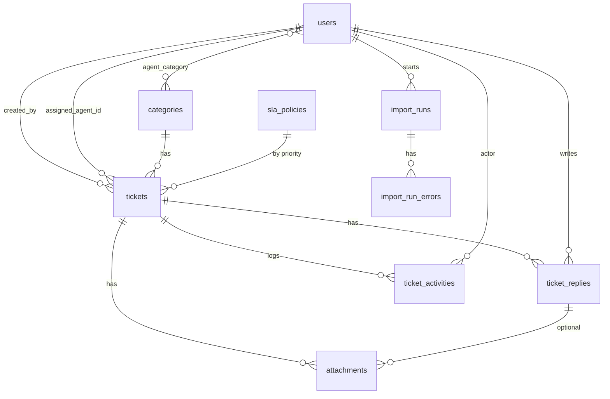

# Support Ticket & SLA Management System: Full Project Plan

Laravel assessment blueprint: scope, architecture, database design, core algorithms, testing, timeline and interview prep.

---

## 1. Summary

| Item | Decision |
|---|---|
| Framework | Laravel 11/12, PHP 8.3 |
| Database | MySQL 8 (or Postgres 15), Redis for queues and cache |
| Frontend | Blade + Tailwind + Alpine.js (Laravel Breeze). No separate SPA. |
| Queue | Redis + `queue:work` (Horizon optional) |
| Scheduler | `schedule:work` / cron for SLA escalation |
| Testing | Pest (feature + unit) |
| Dev environment | Docker (Laravel Sail) + Mailpit |
| Auth | Breeze session auth, role column + Policies |
| Estimated effort (agentic) | 2–3 focused days (about 20–25 h), 3–4 calendar days including review |
| Estimated effort (manual) | 8–12 days |

**Is a frontend needed?** Yes, but a light one. The brief says UI should be "reasonably clean, responsive, and usable" and is not the main focus. Blade keeps authorization server-side and saves time for the backend, which is what is graded. A small JSON API (`/api/v1`) is an optional bonus.

### Assumptions to state in the README
1. Timezone is `Asia/Dhaka`. All timestamps are stored in UTC and converted for display.
2. Business days are Sunday–Thursday, 09:00–18:00. They are configurable via `config/sla.php` and `.env`.
3. The SLA clock does not pause on "Waiting for Customer" (documented, listed as a future extension).
4. No holiday calendar (the brief says full enterprise calendars are out of scope).
5. One role per user. Roles are `admin`, `agent`, `customer`.

---

## 2. Feature Scope and Priority

| Priority | Feature | Notes |
|---|---|---|
| P0 | Ticket CRUD, statuses, ticket number | Core |
| P0 | Roles and policies | Server-side enforcement everywhere |
| P0 | Manual and auto assignment, concurrency-safe accept | Interview focus |
| P0 | SLA calculation with business hours | Interview focus |
| P0 | Escalation scheduler | Idempotent |
| P0 | Replies and internal notes | Notes hidden from customers at query level |
| P0 | Activity/audit history | |
| P0 | Notifications (queued mail + database) | |
| P0 | Search, filters, pagination | Index-aware |
| P0 | Tests for risky logic | |
| P1 | Attachments | Private storage, authorized download |
| P1 | CSV import (queued, chunked) | With progress and error report |
| P1 | Dashboard | Aggregate queries |
| P2 | Docker, CI, API, caching, rate limiting, import progress UI | Bonus only after P0/P1 are solid |

---

## 3. Architecture

### 3.1 Layered structure

```
HTTP layer        Controllers (thin) + FormRequests (validation) + Policies (authorization)
                          |
Service layer     TicketService, TicketAssignmentService, SlaCalculator,
                  TicketNumberGenerator, ActivityLogger, TicketImportService
                          |
Domain/Data       Eloquent Models, Enums, Query Scopes
                          |
Async layer       Events -> Listeners -> Queued Notifications / Jobs
                  Scheduler -> Console Commands (SLA escalation)
```

Rules:
- Controllers call services and return views or resources. They hold no business logic.
- Services own transactions, state changes and activity logging.
- Policies are the only place authorization decisions live.
- Queries for list pages go through model scopes (`Ticket::query()->visibleTo($user)->filter($filters)`).

### 3.2 Folder structure

```
app/
  Enums/            Role, TicketStatus, TicketPriority, ActivityType, ImportStatus
  Models/           User, Ticket, TicketReply, Attachment, TicketActivity,
                    Category, SlaPolicy, TicketSequence, ImportRun, ImportRunError
  Policies/         TicketPolicy, TicketReplyPolicy, AttachmentPolicy, ImportPolicy
  Services/
    Tickets/        TicketService, TicketNumberGenerator, TicketAssignmentService,
                    TicketFilter (search/filter builder)
    Sla/            SlaCalculator, BusinessHours, SlaStatusResolver
    Activity/       ActivityLogger
    Import/         TicketImportService
  Events/           TicketCreated, TicketAssigned, TicketReplied, TicketResolved,
                    TicketEscalated, SlaApproaching
  Listeners/        SendTicketNotifications (queued)
  Notifications/    TicketCreatedNotification, TicketAssignedNotification,
                    ReplyNotification, TicketResolvedNotification,
                    SlaApproachingNotification, SlaBreachedNotification
  Jobs/             ProcessTicketImport
  Console/Commands/ EscalateSlaTickets
  Http/
    Controllers/    TicketController, TicketAssignmentController, TicketReplyController,
                    AttachmentController, DashboardController, ImportController,
                    Admin/SlaPolicyController, Admin/UserController
    Requests/       StoreTicketRequest, UpdateTicketRequest, StoreReplyRequest,
                    AssignTicketRequest, ImportTicketsRequest
config/sla.php
database/migrations, factories, seeders
resources/views/    layouts, tickets, dashboard, imports, admin
tests/Feature, tests/Unit
```

### 3.3 Event and notification flow

| Action | Event | Notifications (queued) |
|---|---|---|
| Ticket created | `TicketCreated` | Customer (confirmation), admins (if unassigned) |
| Assigned | `TicketAssigned` | Assigned agent, customer |
| Agent reply | `TicketReplied` | Customer |
| Customer reply | `TicketReplied` | Assigned agent (or admins if unassigned) |
| Internal note | none | Optionally the assigned agent only. Never the customer. |
| Resolved | `TicketResolved` | Customer |
| SLA warning | `SlaApproaching` | Assigned agent (and admins if unassigned) |
| SLA breached / escalated | `TicketEscalated` | Assigned agent, all admins |

Notifications use `ShouldQueue`, channels `mail` and `database`. Events are dispatched after the DB transaction commits (`DB::afterCommit` or `ShouldDispatchAfterCommit`).

---

## 4. Roles and Permissions

Stored as `users.role` (enum cast). Authorization is via `TicketPolicy` and gates.

| Action | Customer | Agent | Admin |
|---|---|---|---|
| Create ticket | Yes | Yes (on behalf of a customer) | Yes |
| View ticket | Own tickets only | Assigned to self, or unassigned | All |
| Update subject/description | Own, while Open | Assigned tickets | All |
| Change priority/category/status | No | Assigned tickets | All |
| Accept unassigned ticket | No | Yes | Yes |
| Manually assign/reassign | No | No (optionally self-assign only) | Yes |
| Public reply | Own tickets | Assigned tickets | All |
| Internal note | Never | Yes | Yes |
| See internal notes | Never | Yes | Yes |
| Resolve ticket | No | Assigned tickets | All |
| Close ticket | Own (after Resolved) | Assigned tickets | All |
| Download attachment | Own, public replies only | Tickets they can view | All |
| Dashboard | No (own ticket summary only) | Own stats plus queue | Full |
| CSV import | No | No | Yes |
| Manage SLA policies / users | No | No | Yes |

Enforcement:
- Query level: `scopeVisibleTo(User $user)` restricts list queries, so a customer can never receive other users' rows.
- Model level: `$this->authorize()` in controllers, `Gate::authorize` in services where needed.
- Replies: customer queries always add `where('is_internal', false)`. Do this in a scope (`scopeVisibleTo`) rather than in the view.

---

## 5. Database Design

### 5.1 ERD



### 5.2 Tables

#### `users`
| Column | Type | Notes |
|---|---|---|
| id | bigint PK | |
| name, email (unique), password | | |
| role | varchar(20) | `admin`, `agent`, `customer` |
| is_available | boolean default true | Used by auto-assign |
| last_assigned_at | timestamp null | Round-robin tie-break |
| max_open_tickets | smallint null | Optional capacity cap |
| timestamps | | |

Indexes: `unique(email)`, `index(role, is_available)`

#### `categories`
`id`, `name` (unique), `slug` (unique), `is_active`, timestamps

#### `agent_category` (pivot, agent skills)
`user_id`, `category_id`, `primary key(user_id, category_id)`, both FK cascade.

#### `sla_policies`
| Column | Type | Notes |
|---|---|---|
| id | | |
| priority | varchar(20) unique | low, medium, high, critical |
| resolution_minutes | int | Business minutes (48h = 2880, but see note below) |
| warning_threshold_percent | tinyint default 80 | Approaching = elapsed share of the window |
| is_active | boolean | |
| timestamps | | |

Seed: Low 48h, Medium 24h, High 8h, Critical 2h. Changing SLA rules means editing rows (or the admin screen), with no code changes.

> Note: the SLA window is measured in **business time**. "48 hours" means 48 business hours (about 5.3 working days of 9 hours). State this in the README, or add a column `uses_business_hours` if you want a mix.

#### `ticket_sequences`
| Column | Type |
|---|---|
| year | smallint PK |
| last_number | unsigned bigint |

#### `tickets`
| Column | Type | Notes |
|---|---|---|
| id | bigint PK | |
| ticket_number | varchar(20) unique | `TKT-2026-000001` |
| external_ref | varchar(100) unique null | CSV import dedupe key |
| subject | varchar(255) | |
| description | text | |
| priority | varchar(20) | enum |
| status | varchar(30) | enum |
| category_id | FK null | |
| created_by | FK users | Customer |
| assigned_agent_id | FK users null | |
| assigned_at | timestamp null | |
| sla_due_at | timestamp null | Calculated at creation, recalculated on priority change |
| sla_warning_at | timestamp null | Precomputed so the scheduler can use an index |
| approaching_notified_at | timestamp null | Idempotency |
| breached_at | timestamp null | |
| escalated_at | timestamp null | |
| escalation_count | smallint default 0 | |
| first_response_at | timestamp null | Optional metric |
| resolved_at, closed_at | timestamp null | |
| version | unsigned int default 0 | Optional optimistic lock |
| timestamps, soft deletes | | |

Indexes:
- `unique(ticket_number)`, `unique(external_ref)`
- `index(status, priority)` for dashboard and filter
- `index(assigned_agent_id, status)` for agent queue and workload counts
- `index(created_by, status)` for the customer's list
- `index(status, sla_due_at)` for escalation and SLA lists
- `index(status, sla_warning_at)` for the approaching query
- `index(category_id)`, `index(created_at)`
- `fulltext(subject, description)` on MySQL (Postgres: GIN on tsvector)

#### `ticket_replies`
| Column | Type | Notes |
|---|---|---|
| id | | |
| ticket_id | FK cascade | |
| user_id | FK | |
| body | text | |
| is_internal | boolean default false | |
| timestamps | | |

Indexes: `index(ticket_id, is_internal, created_at)`

#### `attachments`
| Column | Type | Notes |
|---|---|---|
| id | | |
| ticket_id | FK cascade | |
| ticket_reply_id | FK null | Null means attached to the ticket itself |
| uploaded_by | FK users | |
| original_name | varchar(255) | Display only, never used for the storage path |
| path | varchar(500) | Hashed name on the private disk |
| mime_type | varchar(100) | Detected server-side |
| size_bytes | unsigned int | |
| sha256 | char(64) null | |
| timestamps | | |

Indexes: `index(ticket_id)`, `index(ticket_reply_id)`

#### `ticket_activities`
| Column | Type | Notes |
|---|---|---|
| id | bigint PK | |
| ticket_id | FK cascade | |
| user_id | FK null | Null for system events (escalation) |
| type | varchar(40) | `created`, `assigned`, `reassigned`, `priority_changed`, `status_changed`, `replied`, `internal_note`, `escalated`, `sla_warning`, `attachment_added` |
| old_value, new_value | varchar(255) null | |
| metadata | json null | |
| created_at | timestamp | |

Indexes: `index(ticket_id, created_at)`. Append-only (no updates).

#### `import_runs`
`id`, `user_id`, `original_filename`, `stored_path`, `status` (pending/processing/completed/failed), `total_rows`, `processed_rows`, `success_rows`, `failed_rows`, `duplicate_rows`, `started_at`, `finished_at`, `failure_reason`, timestamps.

#### `import_run_errors`
`id`, `import_run_id` (FK cascade), `row_number`, `raw_data` (json), `errors` (json), `created_at`. Index: `(import_run_id, row_number)`.

#### Framework tables
`notifications` (database channel), `jobs`, `failed_jobs`, `job_batches` (if batching), `cache`, `sessions`.

---

## 6. Core Designs

### 6.1 Ticket number generation

Goal: unique, ordered, safe under concurrency, supports growth.

```php
// TicketNumberGenerator
public function next(?CarbonInterface $now = null): string
{
    $year = ($now ?? now())->year;

    return DB::transaction(function () use ($year) {
        DB::table('ticket_sequences')->insertOrIgnore(['year' => $year, 'last_number' => 0]);

        $row = DB::table('ticket_sequences')->where('year', $year)->lockForUpdate()->first();
        $next = $row->last_number + 1;

        DB::table('ticket_sequences')->where('year', $year)->update(['last_number' => $next]);

        return sprintf('TKT-%d-%06d', $year, $next);
    });
}
```

- Row lock serializes number allocation. The unique index on `tickets.ticket_number` is a second safety net.
- The counter resets each year. Six digits supports 999,999 per year, and the format simply widens beyond that.
- For bulk import, allocate a range per chunk: `last_number += N` once, then assign numbers in memory.
- Alternative to mention: UUID/ULID plus a display number, or a DB sequence on Postgres.

### 6.2 Assignment

**Manual** (admin): `TicketAssignmentController@store` validates the target is an active agent, runs inside a transaction, logs `assigned` or `reassigned`, and fires `TicketAssigned`.

**Automatic** (`TicketAssignmentService::autoAssign(Ticket $ticket)`), run on ticket creation via a queued job:

1. Candidates are agents with `is_available = true`.
2. If the ticket has a category and at least one candidate has it in `agent_category`, restrict to those. Otherwise use all.
3. Exclude agents at `max_open_tickets` if set.
4. Compute open ticket count per agent with a single grouped query (not N queries).
5. Pick the lowest count. Break ties by oldest `last_assigned_at` (round robin).
6. Assign using the same atomic update as accept (6.3), then update `users.last_assigned_at`.
7. If no candidate exists, leave the ticket unassigned (it stays in the pool and shows on the dashboard).

Strategy name for the README: **category-aware least-workload with round-robin tie-break**.

### 6.3 Concurrent accept (two agents, same ticket)

Atomic conditional update. The database decides the winner:

```php
public function accept(Ticket $ticket, User $agent): bool
{
    return DB::transaction(function () use ($ticket, $agent) {
        $updated = Ticket::query()
            ->whereKey($ticket->id)
            ->whereNull('assigned_agent_id')
            ->whereNotIn('status', [TicketStatus::Resolved, TicketStatus::Closed])
            ->update([
                'assigned_agent_id' => $agent->id,
                'assigned_at'       => now(),
                'status'            => TicketStatus::InProgress,
                'version'           => DB::raw('version + 1'),
            ]);

        if ($updated === 0) {
            return false; // someone else got it
        }

        $this->activity->log($ticket, ActivityType::Assigned, actor: $agent, new: $agent->name);
        event(new TicketAssigned($ticket->fresh(), $agent));

        return true;
    });
}
```

- Controller returns `409 Conflict` (or a flash message: "This ticket was just accepted by another agent") when `false`.
- Why not check-then-update? Two requests can both read `assigned_agent_id = null` and both write. The `WHERE assigned_agent_id IS NULL` makes the check and write one atomic statement.
- Alternative to explain: `lockForUpdate()` inside a transaction (pessimistic). It also works but holds locks longer.
- Test: simulate the loser with a stale model instance (two calls in sequence where the second sees the row already assigned). A true parallel test is optional via process forking.

### 6.4 SLA calculation with business hours

Config (`config/sla.php`):

```php
return [
    'timezone'       => env('SLA_TIMEZONE', 'Asia/Dhaka'),
    'business_days'  => [0, 1, 2, 3, 4],       // Carbon dayOfWeek: 0=Sunday ... 4=Thursday
    'start'          => env('SLA_BUSINESS_START', '09:00'),
    'end'            => env('SLA_BUSINESS_END', '18:00'),
];
```

Algorithm, `SlaCalculator::dueAt(CarbonInterface $start, int $minutes): CarbonImmutable`:

```
cursor = start converted to business timezone
remaining = minutes

loop:
  cursor = nextBusinessMoment(cursor)       // if not within business hours, jump to next open
  endOfDay = cursor's date at business end
  available = minutes between cursor and endOfDay
  if remaining <= available:
      return (cursor + remaining minutes) converted to UTC
  remaining -= available
  cursor = next business day at business start
```

`nextBusinessMoment(cursor)`:
- If cursor is on a business day and between start and end, return cursor.
- If before start on a business day, return that day at start.
- Otherwise (after end or non-business day), return the next business day at start.

Worked example (Critical, 2h = 120 min, created Thursday 17:00):
- Thursday has 60 min left (17:00 to 18:00), so remaining = 60.
- Friday and Saturday are skipped. Sunday 09:00 start, so due = **Sunday 10:00**.

Other edge cases to unit test:
- Created Friday 12:00 (non-business day): the clock starts Sunday 09:00.
- Created Thursday 18:00 exactly (end boundary): treat as after hours, start Sunday 09:00.
- Created before opening (Sunday 07:00): start 09:00 same day.
- A 48h SLA spanning multiple weeks: loop handles it. (Optimization: skip whole days by arithmetic, but the loop is fine at this scale.)
- DST: Bangladesh has none, but run the logic in the business timezone anyway.

`sla_warning_at` is computed as `start + window * warning_threshold_percent` in business time (so "80%" means 80% of the business-time window). Both timestamps are stored on the ticket at creation and recomputed when priority changes (from the change time, or from `created_at`; choose one and document it. Recommended: recompute from `created_at` with the new priority's duration, and log the change).

**SLA status** (`SlaStatusResolver`):

| Status | Condition |
|---|---|
| `met` / `stopped` | Ticket resolved or closed (compare `resolved_at` to `sla_due_at`) |
| `breached` | open and `now > sla_due_at` |
| `approaching` | open and `now >= sla_warning_at` and `now <= sla_due_at` |
| `within` | otherwise |

The same conditions exist as query scopes (`slaBreached()`, `slaApproaching()`, `slaWithin()`) so filtering and the dashboard run in SQL, not in PHP.

### 6.5 SLA escalation

Command `tickets:escalate-sla`, scheduled every minute (`->everyMinute()->withoutOverlapping()->onOneServer()`).

```
1. Approaching:
   tickets open, sla_warning_at <= now, sla_due_at >= now, approaching_notified_at IS NULL
   -> chunkById(200): atomic conditional update setting approaching_notified_at = now
      (WHERE approaching_notified_at IS NULL) -> if updated, log activity + fire SlaApproaching

2. Breached:
   tickets open, sla_due_at < now, escalated_at IS NULL
   -> chunkById(200): atomic conditional update setting breached_at, escalated_at, escalation_count + 1
      (WHERE escalated_at IS NULL) -> if updated, log activity (system actor) + fire TicketEscalated
```

- Idempotent: the conditional update guarantees one escalation even if two scheduler runs overlap.
- Uses the `(status, sla_warning_at)` and `(status, sla_due_at)` indexes.
- Activity entry type `escalated` with metadata (due_at, overdue minutes).
- Notifies assigned agent and all admins. Unassigned tickets notify admins only.

### 6.6 Conversation and internal notes

- `ticket_replies.is_internal` boolean.
- A single query scope: `TicketReply::visibleTo($user)` adds `where is_internal = false` for customers.
- Customers cannot post `is_internal = true`. The FormRequest ignores or rejects the field, and the service enforces it based on role.
- Attachment visibility follows its reply: attachments on internal notes are hidden from customers (policy plus query).
- Status automation: customer reply on `waiting_for_customer` moves to `in_progress`. Agent reply may set `waiting_for_customer` (optional toggle).

### 6.7 Attachments

| Concern | Approach |
|---|---|
| Storage | Private disk (`storage/app/private`), never `public` |
| Filename | `Str::uuid() . '.' . ext`, grouped by `tickets/{ticket_id}/` |
| Validation | `file`, `max:5120` KB, `mimes:pdf,png,jpg,jpeg,gif,txt,csv,docx,xlsx`, max 5 files per request |
| MIME safety | Validate extension and server-detected MIME (`getMimeType()`). Reject executables and SVG/HTML (XSS risk). |
| Access | `AttachmentController@download` authorizes via `AttachmentPolicy` (can the user view the ticket, and is it not an internal-note attachment for a customer?) then streams with `Storage::download()` |
| Headers | `Content-Disposition: attachment`, `X-Content-Type-Options: nosniff` |
| Original name | Stored in DB for display only, sanitized, never used in paths |
| Optional | Virus scanning hook (ClamAV) noted as a future extension |

### 6.8 Search and filtering

`TicketFilter` builds the query from validated request input:

| Filter | Implementation |
|---|---|
| Ticket ID | `where ticket_number like 'TKT-2026-0001%'` (prefix match, uses unique index) |
| Keyword | MySQL `MATCH(subject, description) AGAINST (? IN BOOLEAN MODE)`, with `LIKE` fallback for the SQLite test DB |
| Status, priority, category | `whereIn` |
| Assigned agent | `where assigned_agent_id`, plus a special `unassigned` value |
| Customer | `where created_by` (admin/agent only) |
| Created date | `whereBetween created_at` |
| SLA status | the scopes from 6.4 |

Always: `visibleTo($user)` first, `with(['category:id,name', 'assignee:id,name', 'creator:id,name'])`, `select` only needed columns, `paginate(20)->withQueryString()`.

### 6.9 CSV import

Flow:

```
Admin uploads CSV  ->  validate (file, mimes:csv,txt, max size)  ->  store on private disk
  -> create import_runs (status=pending)  ->  dispatch ProcessTicketImport job  ->  redirect to progress page

Job (queued, timeout high, tries=1, resumable by processed_rows):
  open file with league/csv or SplFileObject (streaming, never load whole file)
  for each chunk of 500 rows:
      validate each row (Validator::make): required subject, valid priority/status,
         category exists (cached lookup map), customer_email resolves/creates customer
      detect duplicates by external_ref (one whereIn query per chunk + unique index)
      compute SLA due/warning for valid rows (reuse SlaCalculator)
      allocate ticket numbers for the chunk (range allocation, see 6.1)
      bulk insert valid rows in a transaction (insert / upsert)
      write invalid rows to import_run_errors with row number and messages
      update import_runs counters
  mark completed (or failed with reason)
```

Details:
- Expected columns: `external_ref, subject, description, priority, category, status, customer_email, created_at`
- Memory stays flat because rows are streamed and chunked.
- Invalid rows never abort the import. They are collected and downloadable as an error CSV.
- Duplicates are skipped and counted, not errors.
- Progress page polls `GET /imports/{id}/progress` (JSON). Optional real-time via broadcasting.
- Imported rows skip notifications (flag on the job) to avoid mailing thousands of people. Activity entries are bulk-inserted as `created` (imported).
- Large-file notes: `public $timeout = 3600`, `failed()` handler marks the run failed, and the job can resume from `processed_rows`.

### 6.10 Dashboard

All numbers come from aggregate queries, one query per widget group, cached 60 seconds for admin.

| Widget | Query |
|---|---|
| Total open | `count where status not in (resolved, closed)` |
| Unassigned | `count where assigned_agent_id is null and status open` |
| Critical open | `count where priority = critical and open` |
| SLA breached | `count where open and sla_due_at < now` |
| Approaching breach | `count where open and sla_warning_at <= now and sla_due_at >= now` |
| Resolved (7/30 days) | `count where resolved_at >= ...` |
| By priority | `select priority, count(*) ... group by priority` |
| By agent | `select assigned_agent_id, count(*) ... group by assigned_agent_id` joined to users |
| By status | `group by status` |

Combine the first several into one query using conditional aggregates (`SUM(CASE WHEN ...)`) to cut round trips. Agents see their own queue stats plus the unassigned pool. Customers see only their own ticket counts.

### 6.11 Activity / audit history

`ActivityLogger::log(Ticket $ticket, ActivityType $type, ?User $actor, $old = null, $new = null, array $meta = [])`

Logged events: created, assigned/reassigned, priority changed, status changed, category changed, reply, internal note, attachment added, escalated, SLA warning, resolved, closed, reopened.

Rendered as a timeline: `10:05 AM – Assigned to Agent B (by Admin A)`. Records are append-only. Internal-note activities are hidden from customers (filter by type for customer view).

---

## 7. Status Workflow

```
Open --> In Progress --> Waiting for Customer --> In Progress
  |            |                  |
  +------------+------------------+--> Resolved --> Closed
                                          |
                                          +--> Reopened (back to In Progress)
```

`TicketStatus` enum with `allowedTransitions()`. `TicketService::changeStatus()` rejects invalid transitions and sets `resolved_at` / `closed_at`.

---

## 8. Routes (web)

| Method | URI | Purpose |
|---|---|---|
| GET | `/dashboard` | Dashboard |
| GET | `/tickets` | List with filters (active/resolved tabs) |
| GET | `/tickets/create`, POST `/tickets` | Create |
| GET | `/tickets/{ticket}` | Detail, conversation, history |
| PUT | `/tickets/{ticket}` | Update |
| POST | `/tickets/{ticket}/accept` | Agent accepts (atomic) |
| POST | `/tickets/{ticket}/assign` | Admin assigns |
| POST | `/tickets/{ticket}/status` | Change status / resolve / close |
| POST | `/tickets/{ticket}/replies` | Reply or internal note |
| GET | `/attachments/{attachment}` | Authorized download |
| GET/POST | `/imports`, `/imports/{run}` | Upload and progress |
| GET | `/imports/{run}/errors` | Download error CSV |
| Resource | `/admin/sla-policies`, `/admin/users` | Admin management |

Optional API: `/api/v1/tickets` (Sanctum token, rate limited, API Resources). Document with a short OpenAPI file or Scribe.

---

## 9. Frontend Pages (Blade + Tailwind + Alpine)

| Page | Contents |
|---|---|
| Layout | Responsive nav, role-aware menu, flash messages |
| Dashboard | Stat cards, priority and agent tables |
| Ticket list | Filter bar, SLA badge (green/amber/red), pagination, Active/Resolved tabs |
| Ticket detail | Header (status, priority, SLA countdown), conversation thread, reply form with "Internal note" toggle (agents only), attachments, activity timeline, assign/accept/status controls per role |
| Create ticket | Form with category, priority, attachments |
| Import | Upload form, progress bar (polling), error table and download |
| Admin | SLA policy editor, user/role management |

---

## 10. Testing Strategy

Test what is risky, and explain why in the README.

| Area | Type | Cases |
|---|---|---|
| SLA calculator | Unit | Created Thursday 17:00 (Critical = Sunday 10:00), after hours, weekend, before opening, exact boundary, multi-day 48h, priority change recompute |
| SLA status | Unit/Feature | within / approaching / breached / resolved-on-time |
| Ticket number | Feature | Sequential, year rollover, uniqueness under repeated calls, format |
| Concurrency | Feature | Second accept returns false/409, exactly one assignee, activity logged once |
| Authorization | Feature | Customer cannot view/update others' tickets, cannot see internal notes, cannot download internal attachments, agent cannot assign others, only admin imports |
| Internal notes | Feature | Not in customer's page, API or notifications |
| Auto-assign | Feature | Least workload wins, category preference, unavailable agent skipped, tie-break, no candidates |
| Escalation | Feature | Warning and breach fire once, rerun is idempotent, resolved tickets ignored, activity and notification created (`Notification::fake()`) |
| Notifications | Feature | Queued (`Queue::fake` / `Notification::fake`) for each event |
| Attachments | Feature | Rejects bad MIME/size, stored privately, unauthorized download blocked |
| Search/filter | Feature | Each filter, pagination, visibility scoping |
| CSV import | Feature | Valid rows, invalid rows reported, duplicates skipped, chunking, large file memory sanity |
| Dashboard | Feature | Counts match seeded data, role-scoped |
| N+1 | Feature | `Model::preventLazyLoading()` enabled in tests and dev |

Use factories for every model. Freeze time with `Carbon::setTestNow()` for SLA tests. Run on MySQL in CI (not only SQLite), since locking and fulltext behave differently.

---

## 11. Phased Timeline (agentic)

| # | Phase | Deliverable | Est. |
|---|---|---|---|
| 0 | Setup | Laravel + Breeze, Sail, Pest, CI skeleton, `CLAUDE.md`/spec in repo | 1 h |
| 1 | Schema | Migrations, enums, models, factories, seeders (users per role, categories, SLA policies) | 2 h |
| 2 | Auth and policies | Role enum, policies, `visibleTo` scopes, policy tests | 1.5 h |
| 3 | Tickets and numbering | CRUD, status workflow, number generator, activity logger | 2 h |
| 4 | Assignment | Manual, auto strategy, atomic accept, concurrency test | 2.5 h |
| 5 | Conversation and attachments | Replies, internal notes, private storage, download policy | 2.5 h |
| 6 | SLA engine | Calculator, config, status scopes, recompute on priority change | 3 h |
| 7 | Escalation and notifications | Scheduler command, events/listeners, queued notifications | 3 h |
| 8 | Search and dashboard | Filters, indexes, pagination, aggregate queries | 2.5 h |
| 9 | CSV import | Job, chunking, errors, progress | 2.5 h |
| 10 | Frontend | Blade pages listed in section 9 | 4 h |
| 11 | Tests and hardening | Fill coverage gaps, enable `preventLazyLoading`, query review | 2.5 h |
| 12 | Docs and polish | README, DECISIONS.md, `.env.example`, optional Docker polish, deploy | 1.5 h |

Total: about 30 h scheduled. With agent assistance, expect 20–25 h of active work. Add review time. Bonus items (API, caching, rate limiting, CI) come only after phase 11.

**Suggested order if time is tight:** 0, 1, 2, 3, 4, 6, 7, 5, 8, 11, 12, then 9 and 10 (a minimal UI) before the polish items.

---

## 12. Working Method (agentic)

1. Put this file and the original assessment in the repo (`docs/`) so each session has full context.
2. One phase per session or prompt. Each phase ends with tests passing and a commit.
3. Read every line of phases 1, 2, 4, 6 and 7 (schema, authorization, concurrency, SLA, escalation). These are the likely interview topics.
4. Keep `DECISIONS.md` updated as you go (one paragraph per decision with the alternative you rejected).
5. Commit small, with clear messages. The history shows your process.
6. Finish with a break-it pass: cross-customer access, internal-note leaks, double accept, giant CSV, SLA edge times.

---

## 13. README Checklist (submission requirements)

- [ ] Project overview and feature list
- [ ] Requirements (PHP, Composer, Node, MySQL, Redis) or Docker instructions
- [ ] Setup: clone, `composer install`, `npm install && npm run build`, `.env` copy, `php artisan key:generate`
- [ ] Database: `php artisan migrate --seed`, and the seeded login accounts (admin/agent/customer demo users)
- [ ] Queue: `php artisan queue:work` (needed for emails and imports)
- [ ] Scheduler: `php artisan schedule:work` or the cron line (needed for escalation)
- [ ] Mail: Mailpit/log driver config
- [ ] Storage: private disk, `storage:link` not required for attachments
- [ ] Running tests: `php artisan test` (or `./vendor/bin/pest`)
- [ ] Architecture overview and the decisions from this document (ticket number, assignment, concurrency, SLA, escalation, import)
- [ ] Assumptions (section 1)
- [ ] Known limitations and future work (SLA pause, holidays, virus scanning, per-customer SLA)
- [ ] No secrets committed; `.env.example` only
- [ ] Optional demo URL

---

## 14. Interview Preparation

Questions you should be able to answer without looking at the code:

| Question | Short answer |
|---|---|
| How do you prevent two agents accepting the same ticket? | Single conditional `UPDATE ... WHERE assigned_agent_id IS NULL`, checking affected rows. The DB serializes the race. |
| Why not just check then update? | There is a race window between the read and the write. |
| How is the ticket number unique under load? | Row lock on `ticket_sequences` inside a transaction, plus a unique index as backup. |
| How does SLA handle after-hours? | Walk forward day by day, consuming business minutes and skipping non-business time. Thursday 17:00 + 2h = Sunday 10:00. |
| Why store `sla_due_at` instead of computing it? | Indexable queries for breach/approaching, and cheap scheduler scans. |
| What happens if priority changes? | Recompute due and warning timestamps, log the change, reset notification flags if needed. |
| How do you avoid double escalation? | Conditional update on `escalated_at IS NULL`, plus `withoutOverlapping`. |
| How are internal notes protected? | Query scope removes them for customers, policy checks on attachments, and notification logic never targets customers. |
| How do you handle N+1? | Eager loading with column selection, `preventLazyLoading()`, grouped queries for counts. |
| What are your indexes for and what would you add at 10M tickets? | Listed in section 5. At scale: partition or archive closed tickets, move search to Meilisearch/Elasticsearch, cache dashboard counts. |
| How does import avoid memory blowup? | Streams rows, processes in chunks of 500, bulk inserts, and writes errors to a table. |
| How would you add "pause SLA while waiting for customer"? | Track `paused_at` and accumulated paused business minutes, then recompute `sla_due_at` on resume. |
| Small change they might ask for | Change business hours or SLA durations (config/DB only), add a status, add a role permission, add a filter, change the auto-assign rule. |

---

## 15. Future Extensions (mention, don't build)

- SLA pause on "Waiting for Customer", first-response SLA, holiday calendar
- Per-customer or per-category SLA overrides
- Real-time updates with Laravel Reverb
- Meilisearch for keyword search
- Virus scanning for attachments
- Audit log export, reporting with date ranges
- Soft limits and rate limiting on ticket creation